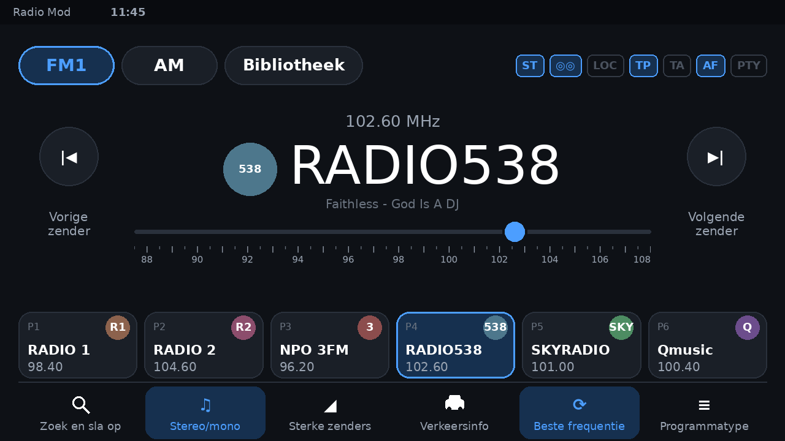
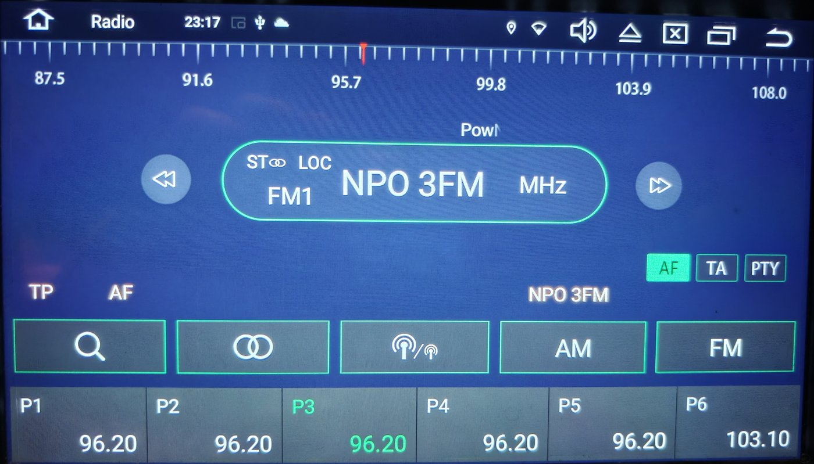
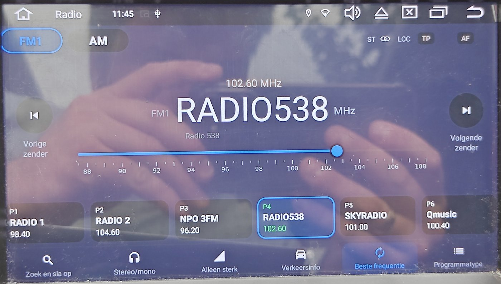
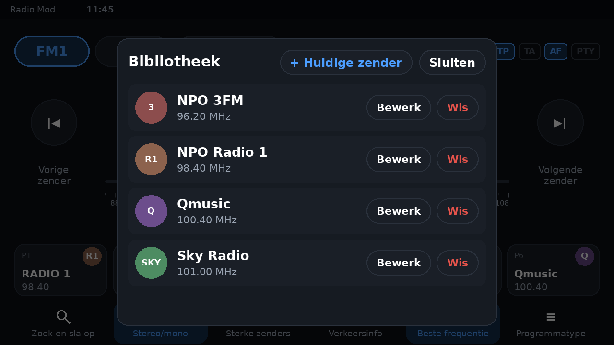

# Android Headunit Radio Modification

Een vernieuwde, moderne interface voor de FM-radio-app van Android-headunits met de ZiQi-firmware (`android.car.app.radio`). Gemaakt voor een 10"-scherm in een Skoda Yeti, maar bruikbaar op elke headunit met dezelfde radio-app.

De aangepaste app wordt **naast** de originele radio-app geïnstalleerd. Het origineel blijft onaangetast.



> **Let op:** deze repository bevat geen enkele code of afbeelding van de originele app. Je haalt de radio-app zelf van je eigen headunit en past deze kit erop toe. Zie [Juridisch](#juridisch).

---

## Voor en na

| Origineel | Nieuw |
|---|---|
|  |  |

*De foto rechts is een tussenversie tijdens de ontwikkeling. Het actuele ontwerp staat bovenaan deze pagina.*

---

## Wat er anders is

**Uiterlijk**
- Donker, rustig ontwerp met afgeronde kaarten en duidelijke knoppen met icoon én tekst
- Grote zendernaam met het logo van de zender ernaast; de frequentie staat klein erboven
- Schuif met een strakke frequentieschaal om handmatig af te stemmen
- Statuslampjes (ST, stereo, LOC, TP, TA, AF, PTY) altijd zichtbaar, duidelijk aan of uit
- Knoppen worden blauw zolang de functie aan staat

**Favorieten**
- Zendernaam, frequentie en een klein logo op elke knop
- Doorlopende nummering: FM1 = P1–P6, FM2 = P7–P12, FM3 = P13–P18
- De FM-knop toont in welke groep je zit

**Bibliotheek**



- Eigen lijst met zenders en frequenties, met logo's
- Tik op een zender om er direct op af te stemmen
- Zenders toevoegen (de huidige zender met één tik), bewerken en verwijderen
- Wordt apart opgeslagen: **Zoek en sla op** wist de lijst niet

**Gedrag**
- Waarschuwing vóór **Zoek en sla op**, met uitleg wat er wordt overschreven
- Na het starten van de auto komt deze app automatisch over het origineel heen (maar niet als je al naar bijvoorbeeld Maps bent gegaan)
- Na het afspelen van andere audio (zoals een mp3-speler) wordt het FM-geluid automatisch teruggehaald

---

## Geschikt voor

| | |
|---|---|
| Radio-app | pakket `android.car.app.radio`, versie `LeiMa_2024-02-23` |
| Fabrikant firmware | ZiQi (ShenZhen) |
| Scherm | 1280×720, dichtheid 240 (Android kiest de map `layout-w800dp-h420dp`) |
| Android | 13 |

Heb je een andere versie? Het script controleert vóór elke wijziging of de code er uitziet zoals verwacht. Klopt dat niet, dan stopt het met een melding en verandert het **niets**.

---

## Benodigdheden

- Een computer met Linux (of macOS/WSL) met:
  - Java (JDK 17 of nieuwer)
  - [apktool](https://apktool.org/) 3.x
  - `zipalign` en `apksigner` (Android build-tools)
  - Python 3
- Een manier om de radio-app van je headunit te halen, bijvoorbeeld een *APK Extractor*-app uit de Play Store
- Een USB-stick om de nieuwe app te installeren

Op een Arch-gebaseerd systeem (zoals CachyOS):

```bash
sudo pacman -S jdk-openjdk android-tools python
paru -S android-apktool-bin android-sdk-build-tools
```

---

## Installatie

### 1. Radio-app van je headunit halen

Gebruik een APK-extractor op de headunit en kopieer de radio-app (pakket `android.car.app.radio`) naar je computer, bijvoorbeeld als `Radio.apk`.

### 2. Uitpakken

```bash
apktool d Radio.apk -o radio_src
```

### 3. De kit toepassen

Download de [nieuwste release](https://github.com/PlanerNL/Android-Headunit-Radio-Modification/releases/latest), of clone deze repository:

```bash
git clone https://github.com/PlanerNL/Android-Headunit-Radio-Modification.git
```

Voer daarna het script uit (pas het pad aan naar waar je de kit hebt staan):

```bash
python3 Android-Headunit-Radio-Modification/apply_mod.py radio_src
```

Het script:
- geeft de app een eigen pakketnaam, zodat hij naast het origineel kan staan
- past de layout, kleuren, teksten en code aan
- maakt de map `radio_src/assets/RadioLogos/` aan voor je zenderlogo's

Opties:

| Optie | Betekenis | Standaard |
|---|---|---|
| `--package=...` | pakketnaam van de nieuwe app | `nl.planernl.radiomod` |
| `--name="..."` | naam in het app-menu | `Radio Mod` |

Je kunt het script veilig opnieuw draaien, bijvoorbeeld na een update van deze kit: het voegt alleen toe wat nog ontbreekt.

### 4. Zenderlogo's toevoegen (optioneel)

Zet afbeeldingen in `radio_src/assets/RadioLogos/`. De bestandsnaam is de zendernaam uit je Bibliotheek in kleine letters, zonder spaties of leestekens:

| Zender in de Bibliotheek | Bestandsnaam |
|---|---|
| NPO Radio 1 | `nporadio1.png` |
| NPO 3FM | `npo3fm.png` |
| Radio 538 | `radio538.png` |
| Sky Radio | `skyradio.png` |

`.png`, `.jpg`, `.jpeg` en `.webp` werken. Vierkant, rond de 128×128 pixels, is ideaal.

Logo's van zenders zijn eigendom van die zenders en zitten daarom niet in deze repository. Zonder logo krijgt een zender een gekleurd rondje met de beginletters.

### 5. Bouwen en ondertekenen

```bash
apktool b radio_src -o Radio_mod.apk
zipalign -p -f 4 Radio_mod.apk Radio_aligned.apk
```

De eerste keer maak je een eigen sleutel. **Bewaar die goed**: zonder dezelfde sleutel kun je later geen update meer installeren.

```bash
keytool -genkey -v -keystore mijn.keystore -alias mod -keyalg RSA -keysize 2048 -validity 10000
```

Ondertekenen:

```bash
apksigner sign --ks mijn.keystore Radio_aligned.apk
```

### 6. Installeren

Zet `Radio_aligned.apk` op een USB-stick, open hem op de headunit met de bestandsbeheerder en installeer. Open de app daarna één keer met de hand.

### 7. Instellingen op de headunit

Zodat de nieuwe app na het starten van de auto voorrang krijgt:

1. Geef de nieuwe app de toestemming **Weergeven vóór andere apps**.
2. Zet diezelfde toestemming **uit** voor de originele radio-app.

---

## Hoe het werkt (en wat niet kan)

De headunit schakelt het FM-geluid alleen in voor de originele radio-app. Daarom:

- blijft het origineel geïnstalleerd en draait het op de achtergrond;
- opent deze app het origineel heel even als het geluid op een andere bron staat (je ziet het kort flitsen);
- meldt deze app zich bij de autodienst van de headunit aan met de pakketnaam van het origineel.

De bediening van de tuner, RDS en de favorieten werken via dezelfde dienst als het origineel; de favorieten worden dus gedeeld.

---

## Problemen oplossen

| Probleem | Oplossing |
|---|---|
| "App niet geïnstalleerd" | De APK is niet (goed) ondertekend, of een eerdere versie is met een andere sleutel ondertekend. Verwijder die eerst. |
| Geen geluid | Open één keer de originele radio-app en daarna deze app. |
| App komt na het starten niet naar voren | Controleer de toestemmingen uit stap 7. Open de app één keer met de hand na een *geforceerd stoppen*. |
| Layout klopt niet / valt buiten beeld | Je scherm gebruikt waarschijnlijk een andere layoutmap. Bouw met `python3 apply_mod.py radio_src --randtest` om hulplijnen en de mapnaam te zien. |
| Script stopt met `FOUT:` | Je radio-app wijkt af van de geteste versie. Er is dan niets veranderd. |

---

## Voor ontwikkelaars

```
apply_mod.py          past alles toe op een uitgepakte radio-app
mod/                  nieuwe resources en smali-klassen
src/                  Java-broncode van de Bibliotheek (ModStations)
tools/gen_layout.py   genereert de layouts voor beide schermformaten
tools/build_java.sh   compileert src/ opnieuw naar smali
tools/stubs/          minimale stubs om tegen de app-klassen te compileren
extra/                testlayout met hulplijnen (--randtest)
```

Layout aanpassen:

```bash
python3 tools/gen_layout.py small mod/res/layout-w800dp-h420dp/ui2_activity_radio.xml
python3 tools/gen_layout.py big   mod/res/layout-w1150dp-h420dp/ui2_activity_radio.xml
```

Java opnieuw bouwen (alleen nodig na wijzigingen in `src/`):

```bash
ANDROID_JAR=android-28.jar DX_JAR=dx.jar APKTOOL_JAR=apktool.jar ORIGINAL_APK=Radio.apk tools/build_java.sh
```

---

## Juridisch

Dit is een onofficieel hobbyproject. Het heeft niets te maken met ZiQi, Skoda of de radiozenders die in de voorbeelden worden genoemd.

Deze repository bevat **uitsluitend** eigen werk: het script, de toegevoegde layouts, afbeeldingen, teksten en code. De originele radio-app, de uitgepakte code en zenderlogo's worden niet meegeleverd en mogen niet in deze repository worden geplaatst. Gebruik deze kit alleen met de app van je eigen headunit.

Gebruik op eigen risico.

## Licentie

[MIT](LICENSE) © 2026 PlanerNL. De licentie geldt alleen voor de bestanden in deze repository, niet voor de originele radio-app.
